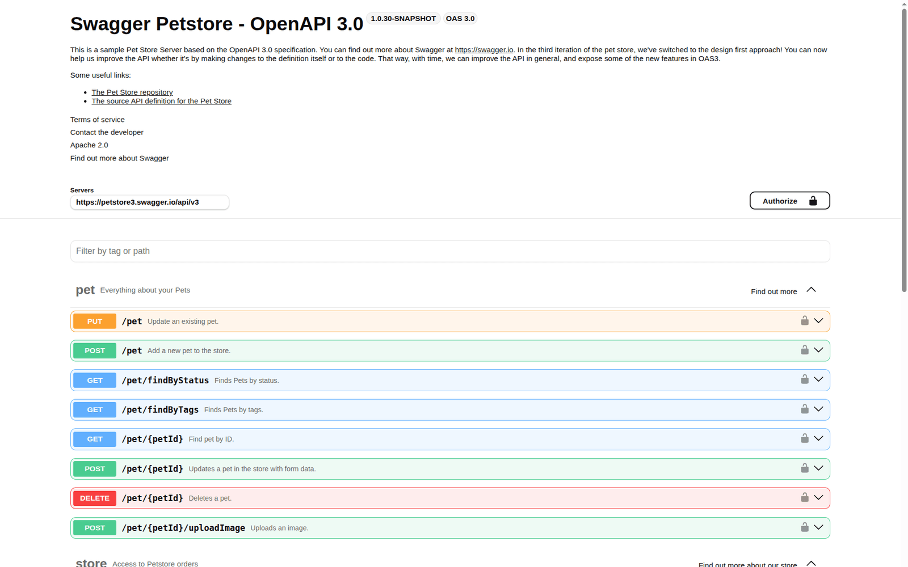

# OpenAPI Preview

An [Orca](https://github.com/stablyai/orca) plugin that previews OpenAPI/Swagger files beside the
YAML — the same thing GitLab does when you open a spec.

Title and version, a server picker, endpoints grouped by tag with colour-coded method badges, an
accordion with parameters and responses, and the Schemas section. The file opens straight into that
view, with **Source** on the next tab for the raw YAML.

<picture>
  <source media="(prefers-color-scheme: dark)" srcset="assets/screenshot-dark.png">
  
</picture>

## Install

```sh
orca plugin install Tagliatti/orca-openapi
```

Pin a version with `Tagliatti/orca-openapi@v0.1.0`. In the app, the same thing through
Settings → Plugins → Install plugin.

The plugin runs code, so Orca asks for approval first and shows exactly what it would grant: a
sandboxed editor frame that reads every file it opens, and no capabilities.

## What it opens

Known file names only, matching GitLab's defaults:

```
openapi.yaml  openapi.yml  openapi.json
swagger.yaml  swagger.yml  swagger.json
```

Arbitrary `.yaml` files are left alone. Orca treats `.yaml` as a type it opens itself, and by
default such files would land as a secondary tab — but registering by **file name** beats that
rule, so these files open **directly in the API view**.

It is **read-only**: it reads the file and draws it, never writes back, so the tab never goes dirty.
It re-renders by itself when the file changes from outside.

## Limits (the editor frame is isolated)

- **No network.** Swagger UI is vendored inside the plugin; nothing comes from a CDN.
- **No filesystem access.** An internal `$ref` (`#/components/...`) works; a `$ref` to another file
  does not resolve, and the preview says which ones it found.
- **"Try it out"/Execute are hidden**, since there would be no network to reach the server.
- Desktop app only: the plugin sets `frame: "isolated"`, so in browser clients the file opens in
  Source with a notice instead.

## Development

```sh
node scripts/vendor.mjs   # downloads swagger-ui-dist and js-yaml into editor/vendor/
orca plugin test .        # unit tests (node:test)
orca plugin check .       # validates and statically checks the editor
orca plugin validate .
orca plugin dev watch .   # loads it into Orca with logs and reload; Ctrl-C unloads
```

See the editor without opening it by hand:

```sh
orca plugin open local.openapi-preview --editor ./sample/openapi.yaml
orca plugin shot . --editor ./sample/openapi.yaml --json   # PNG into .orca/shots/
```

Loading needs approval: `orca plugin dev load .` prints the access it asks for and the `--approve`
fingerprint.

## Layout

```
orca-plugin.json        manifest; registers the custom editor
editor/index.html       the editor entry (HTML: <link> for CSS, <script> for the bundles)
editor/app.mjs          wires Orca's document to Swagger UI
editor/spec.mjs         parseSpec(): validates and summarises a spec (pure, tested)
editor/options.mjs      buildSwaggerOptions(): what to switch on and off (pure, tested)
editor/theme.css        adapts Swagger UI to the --orca-* variables
editor/vendor/          swagger-ui-bundle.js, swagger-ui.css, js-yaml.mjs (generated)
scripts/vendor.mjs      downloads and copies the vendored files, with pinned versions
sample/openapi.yaml     the Swagger Petstore spec, used for the screenshots
assets/screenshot-*.png the plugin page screenshots, one per theme
```

Regenerate them with `orca plugin shot . --editor ./sample/openapi.yaml`, once in each theme, then
normalise both to 16:10. The manifest requires each to be at least 1280×800 and at most 1536 KB, and
each `alt` to be at most 160 characters. The capture size follows Orca's editor pane rather than the
`--width`/`--height` flags, so the normalising step is what keeps the pair identical.

The vendored versions are pinned in `scripts/vendor.mjs`; changing them there and running it again is
how you update. Swagger UI is Apache-2.0 and js-yaml is MIT — both licences are in `editor/vendor/`.

## Sample spec

`sample/openapi.yaml` is the Swagger Petstore example from
[swagger-api/swagger-petstore](https://github.com/swagger-api/swagger-petstore), Apache-2.0. It is
only a fixture for the screenshot and the manual checks; the plugin never reads it.

## Why these vendored files

- `swagger-ui-bundle.js` — the UMD build, which defines a global `SwaggerUIBundle`. It is the only
  format that works through `<script src>`: `swagger-ui-es-bundle.js` has no ESM export at all,
  only `module.exports`.
- `js-yaml.mjs` — the ESM build, self-contained (zero external imports), with named exports.
